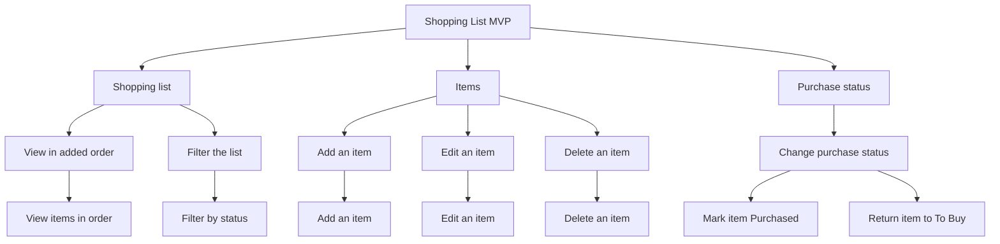

# Feature Tree

**Product:** Shopping List
**Version:** 1.4
**Date:** 2026-10-19
**Author:** Liliia (BA)
**Status:** Baselined

---

## Feature Tree

| ID | L1 Area | L2 Capability | L3 Features | Tag | Entity | Source | Notes |
|---|---|---|---|---|---|---|---|
| | Shopping list | View the shopping list in added order | | MVP | | `[prd S6]` | UC-02 |
| F-001 | | | View items in added order | MVP | [SHOPPING_LIST](../domain/erd/entities/SHOPPING_LIST.md), [ITEM](../domain/erd/entities/ITEM.md) | `[prd S5]` | Items stay in the order they were added |
| F-002 | | | Keep more than one shopping list | Future | | `[prd S6]` | PRD S6.3 deferred. Not a commitment |
| F-003 | | | Keep a store-specific shopping list | Future | | `[prd S6]` | PRD S6.3 deferred. Not a commitment |
| F-004 | | | Import or export the shopping list | Future | | `[prd S6]` | Excluded from this version. No later phase named |
| F-005 | | | Use a user account | Future | | `[prd S6]` | PRD S6.3 deferred. Not a commitment. No access area in PRD S6 |
| F-006 | | | Share the list with a controlled set of people | Future | | `[prd S6]` | PRD S6.3 deferred. Not a commitment. Whether this is the same concept as user permissions is open in the glossary |
| F-007 | | | Set user permissions | Future | | `[prd S6]` | Excluded from this version. No later phase named |
| F-008 | | | Send a notification | Future | | `[prd S6]` | Excluded from this version. No later phase named |
| F-009 | | | Use a native mobile application | Future | | `[prd S6]` | PRD S6.3 deferred. A channel, not a list action. Not a commitment |
| | | Filter the shopping list by All, To Buy, or Purchased | | MVP | | `[prd S6]` | UC-02 |
| F-010 | | | Filter by All, To Buy, or Purchased | MVP | [ITEM](../domain/erd/entities/ITEM.md) | `[prd S5]` | One action. Values are All, To Buy, and Purchased |
| | Items | Add an item with a name and a quantity | | MVP | | `[prd S6]` | UC-01 |
| F-011 | | | Add an item | MVP | [SHOPPING_LIST](../domain/erd/entities/SHOPPING_LIST.md), [ITEM](../domain/erd/entities/ITEM.md) | `[prd S5]` | Required: item name, quantity. Quantity defaults to 1. The item starts as To Buy. Duplicate names are allowed |
| F-012 | | | Add an item from a barcode | Future | | `[prd S6]` | Excluded from this version. No later phase named |
| | | Edit an item | | MVP | | `[prd S6]` | UC-04 |
| F-013 | | | Edit an item | MVP | [ITEM](../domain/erd/entities/ITEM.md) | `[prd S5]` | Item name and quantity |
| F-014 | | | Record a price | Future | | `[prd S6]` | PRD S6.3 deferred. Not a commitment |
| F-015 | | | Set an item unit | Future | | `[prd S6]` | Excluded from this version. No later phase named |
| F-016 | | | Attach a product image | Future | | `[prd S6]` | Excluded from this version. No later phase named |
| | | Delete an item | | MVP | | `[prd S6]` | UC-04 |
| F-017 | | | Delete an item | MVP | [ITEM](../domain/erd/entities/ITEM.md) | `[prd S5]` | Confirmation is part of this action |
| | Purchase status | Change an item between To Buy and Purchased | | MVP | | `[prd S6]` | UC-03 |
| F-018 | | | Mark an item Purchased | MVP | [ITEM](../domain/erd/entities/ITEM.md) | `[prd S5]` | |
| F-019 | | | Return an item to To Buy | MVP | [ITEM](../domain/erd/entities/ITEM.md) | `[prd S5]` | |

### Full Feature Tree

```mermaid
graph TD
    Root[Shopping List]

    Root --> List[Shopping list]
    List --> View[View in added order]
    View --> F001[View items in order]
    View --> F002[Keep multiple lists]
    View --> F003[Keep a store-specific list]
    View --> F004[Import or export the list]
    View --> F005[Use a user account]
    View --> F006[Share the list]
    View --> F007[Set user permissions]
    View --> F008[Send a notification]
    View --> F009[Use a native mobile app]
    List --> Filter[Filter the list]
    Filter --> F010[Filter by status]

    Root --> Items[Items]
    Items --> Add[Add an item]
    Add --> F011[Add an item]
    Add --> F012[Add from a barcode]
    Items --> Edit[Edit an item]
    Edit --> F013[Edit an item]
    Edit --> F014[Record a price]
    Edit --> F015[Set an item unit]
    Edit --> F016[Attach a product image]
    Items --> Delete[Delete an item]
    Delete --> F017[Delete an item]

    Root --> Status[Purchase status]
    Status --> Change[Change purchase status]
    Change --> F018[Mark item Purchased]
    Change --> F019[Return item to To Buy]
```

### MVP Scope

---

## Decision Log

| L1 / L2 / L3 | Decision | Rationale | Depends on | Decided by | Date |
|---|---|---|---|---|---|
| Shopping list, Items, Purchase status | These are the three areas | They are the PRD Section 6 areas. Shopping list traces to UC-02. Items traces to UC-01 and UC-04. Purchase status traces to UC-03 | PRD S5, PRD S6 | Liliia (BA) | 2026-10-01 |
| Item name, Quantity | Not separate features | They are required parts of add and edit | PRD S5 | Liliia (BA) | 2026-10-01 |
| F-011 | A new item starts as To Buy inside add | That starting condition is not its own action | PRD S6 | Liliia (BA) | 2026-10-01 |
| F-017 | Confirmation stays inside delete | It is not a separate action | PRD S5 | Liliia (BA) | 2026-10-01 |
| F-010 | One feature for All, To Buy, and Purchased | The person applies one filter and chooses a value | PRD S5 | Liliia (BA) | 2026-10-01 |
| F-018, F-019 | Two features under one capability | Marking Purchased and returning to To Buy are different outcomes | PRD S5 | Liliia (BA) | 2026-10-01 |
| Primary user, Secondary user, Household | No feature | They say who the shopping list is for. They are not actions | Domain glossary | Liliia (BA) | 2026-10-01 |
| F-002 through F-009, F-012, F-014 through F-016 | Placed under the nearest in-scope capability. Tag left empty | PRD Section 6.2 names no next release. Section 6.3 possibilities are not a commitment. An area with no use case was not added. Scope tags wait for a later scoping step | PRD S6 | Liliia (BA) | 2026-10-01 |
| API | No feature | The acronym is not a shopping-list concept | Domain glossary | Liliia (BA) | 2026-10-01 |
| View, Filter, Add, Edit, Delete, Change purchase status | L2 tag MVP | Each capability has a day-1 feature in the operator's tag list | Operator tag list, 2026-10-15 | Liliia (BA) | 2026-10-15 |
| F-001, F-010, F-011, F-013, F-017, F-018, F-019 | Tag MVP | The operator assigned MVP. These are the version-1 behaviors Whitney confirmed: view, filter, add, edit, delete, mark Purchased, and return to To Buy. Research stays simulated and is not the basis of the tag | Operator tag list, 2026-10-15; PRD S6 | Liliia (BA) | 2026-10-15 |
| F-002 | Tag Future | The operator assigned Future. A later phase could include more than one list. That phase is not a commitment | Operator tag list, 2026-10-15; PRD S6 | Liliia (BA) | 2026-10-15 |
| F-003 | Tag Future | The operator assigned Future. A later phase could include a store-specific list. That phase is not a commitment | Operator tag list, 2026-10-15; PRD S6 | Liliia (BA) | 2026-10-15 |
| F-004 | Tag Future | The operator assigned Future. The product requirements document had excluded import and export from version 1 and named no later phase | Operator tag list, 2026-10-15; PRD S6 | Liliia (BA) | 2026-10-15 |
| F-005 | Tag Future | The operator assigned Future. A later phase could include a user account. That phase is not a commitment | Operator tag list, 2026-10-15; PRD S6 | Liliia (BA) | 2026-10-15 |
| F-006 | Tag Future | The operator assigned Future. A later phase could include controlled sharing. That phase is not a commitment. Whether this is the same concept as user permissions stays open | Operator tag list, 2026-10-15; PRD S6 | Liliia (BA) | 2026-10-15 |
| F-007 | Tag Future | The operator assigned Future. The product requirements document had excluded user permissions from version 1 and named no later phase | Operator tag list, 2026-10-15; PRD S6 | Liliia (BA) | 2026-10-15 |
| F-008 | Tag Future | The operator assigned Future. The product requirements document had excluded notifications from version 1 and named no later phase | Operator tag list, 2026-10-15; PRD S6 | Liliia (BA) | 2026-10-15 |
| F-009 | Tag Future | The operator assigned Future. A later phase could include a native mobile application. That phase is not a commitment. It is a channel, not a list action | Operator tag list, 2026-10-15; PRD S6 | Liliia (BA) | 2026-10-15 |
| F-012 | Tag Future | The operator assigned Future. The product requirements document had excluded barcode scanning from version 1 and named no later phase | Operator tag list, 2026-10-15; PRD S6 | Liliia (BA) | 2026-10-15 |
| F-014 | Tag Future | The operator assigned Future. A later phase could include a price. That phase is not a commitment | Operator tag list, 2026-10-15; PRD S6 | Liliia (BA) | 2026-10-15 |
| F-015 | Tag Future | The operator assigned Future. The product requirements document had excluded item units from version 1 and named no later phase | Operator tag list, 2026-10-15; PRD S6 | Liliia (BA) | 2026-10-15 |
| F-016 | Tag Future | The operator assigned Future. The product requirements document had excluded a product image from version 1 and named no later phase | Operator tag list, 2026-10-15; PRD S6 | Liliia (BA) | 2026-10-15 |
| MVP boundary | Approved. No tag change | The operator said the team and the stakeholder approved this boundary | Operator statement, 2026-10-15 | Team and stakeholder | 2026-10-15 |

---

## Version History

| Version | Trigger | What changed | New inputs required |
|---|---|---|---|
| v1.0 | 2.2 Feature tree | Areas and capabilities from PRD Section 6. Features from the glossary questions and from PRD Section 6.3. Identifiers F-001 through F-019. Tag and Entity left empty | PRD, domain glossary, domain brief |
| v1.1 | 2.5 Entity-relationship index and entity specs | Entity column filled for the seven current features from the reviewed draft mapping. Deferred and excluded features stay empty | Reviewed entity-relationship draft |
| v1.2 | 4.1 Minimum viable product workshop | Operator tag list applied. Seven features MVP. Twelve features Future. No v1.1 tag. MVP diagram filled | Operator tag list, 2026-10-15 |
| v1.3 | 4.2 Stakeholder validation | Sign-off recorded. No tag change | Operator statement, 2026-10-15 |
| v1.4 | 7.2 Stakeholder sign-off | Baselined. No tag change. The team and the stakeholder approved the product requirements document. | Operator statement, 2026-10-19 |

---

## Sources

| Prefix | Document |
|---|---|
| `[prd]` | [PRD.md](PRD.md) |
| `[glossary]` | [domain-glossary.md](../domain/domain-glossary.md) |
| `[domain-brief]` | [domain-brief.md](../domain/domain-brief.md) |
