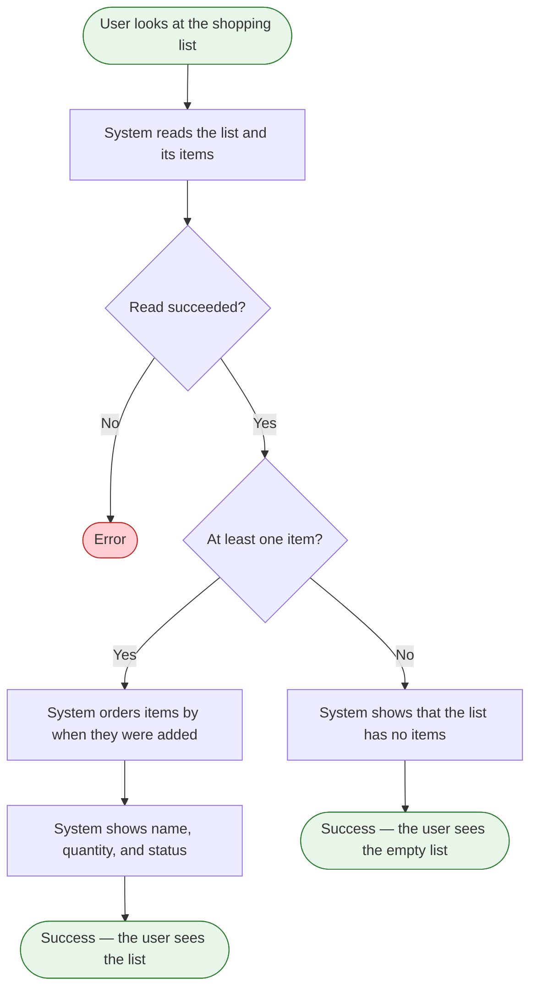

# View the shopping list

**Product:** Shopping List
**Use Case:** UC-02 See what is still needed
**Area:** Shopping list
**Capabilities:** View the shopping list in added order
**Version:** 1.9
**Date:** 2026-10-19
**Author:** Liliia (BA)

> The user looks at the one shopping list. Items stay in the order they were added.

---

## Overview

**Goal:** Show the shopping list so the user can see each item's name, quantity, and status. `[prd]`
**Actors:** User. No permission limits this action to one role.
**Trigger:** The user looks at the shopping list. `[prd]`
**Preconditions:** Version 1 has one shopping list. `[glossary]` Weekly shopping and quick top-up shopping use the same workflow. 

---

## Flow Diagram

---

## Flow Steps

| # | Actor | Action | System Response | Screen / Component | BR |
|---|---|---|---|---|---|
| 1 | User | Looks at the shopping list | Starts reading the one list and its items | `[gap: screen not mapped]` | |
| 2 | System | Reads the shopping list and its items | Has the items, or the read fails | `[gap: screen not mapped]` | |
| 3 | System | Orders the items by when they were added | Items follow `createdAt`. Two items cannot share that timestamp. `[operator]` | `[gap: screen not mapped]` |  |
| 4 | System | Shows each item | Shows the name, the quantity, and the status. The identifier and the timestamps stay hidden. Two items with the same name both appear | `[gap: screen not mapped]` | `[BR-001](../business-rules-catalog.md)` |
| 5 | User | Sees the shopping list | The list stays in added order | `[gap: screen not mapped]` | |

---

## Error and Edge Cases

| Scenario | Behavior | BR |
|---|---|---|
| The read in step 2 fails | "Couldn't load your shopping list. Try again." The user tries the load again. `[operator-2]` | |
| The shopping list has zero items | The list shows that it has no items, and the user can add an item. `[gap: message wording]` `[gap: whether that starts the add flow]` | |
| Two items share `createdAt` | This does not occur. Each item has its own timestamp, so added order has no tie. `[operator]` | |
| Two items have the same name | Both items appear. A matching name does not warn and does not block. `[operator]` | `[BR-001](../business-rules-catalog.md)` |

### Decision Nodes

| After step # | Condition | Yes / Valid → | No / Invalid → | BR |
|---|---|---|---|---|
| 2 | The read succeeded | Step 3 when the list has at least one item. The list shows that it has no items when it has zero | Load message. The user tries the load again | |

### Error States

| Triggered at step # | Error condition | What the user sees | Recovery path |
|---|---|---|---|
| 2 | The list cannot be read | "Couldn't load your shopping list. Try again." | The user tries the load again. `[gap: retry control or page reload]` |

---

## Friction Points

No friction is recorded.

**Scope signals:** No scope signal.

---

## Traceability

**Features:** [F-001](../feature-tree.md)
**Entities:** [SHOPPING_LIST](../../domain/erd/entities/SHOPPING_LIST.md) (read), [ITEM](../../domain/erd/entities/ITEM.md) (read)
**Rules:** `[BR-001](../business-rules-catalog.md)`
**NFRs:** none. Page-load time stays a gap in the product requirements document.

---

## Version History

| Version | Stage | What changed |
|---|---|---|
| v1.0 | 5.1 General flows | Initial flow from the product sources. Markers only. |
| v1.1 | 5.1 General flows | Markers replaced with catalog identifiers. No step change. |
| v1.2 | 5.1 General flows | Actor is User. The diagram error end says Error. No control name and no message wording. |

| v1.3 | 5.1 General flows | Diagram ends and gaps say user. |
| v1.4 | 5.1 General flows | UX, terminology, field-default, and common-behavior identifiers removed. |

| v1.5 | 5.1 General flows | Sorting and confirmation identifiers removed after classification review. |

| v1.6 | 5.1 General flows | Rule identifiers renumbered to BR-001 and BR-002. |
| v1.7 | 5.2 Team refinement | A shared `createdAt` does not occur. The tie-break gap is closed. |
| v1.8 | 5.2 Team refinement | Duplicate names stay allowed. The warn-or-block gap is closed. |
| v1.9 | 6.1 Entity enrichment | Load-failure message and recovery from the operator-approved entity decisions. |

---

## Sources

| Marker | Source | Link |
|---|---|---|
| `[prd]` | Product requirements document | [PRD.md](../PRD.md) |
| `[feature-tree]` | Feature tree | [feature-tree.md](../feature-tree.md) |
| `[entities]` | Entity specs | [ITEM.md](../../domain/erd/entities/ITEM.md) |
| `[glossary]` | Domain glossary | [domain-glossary.md](../../domain/domain-glossary.md) |
| `[operator]` | Operator, 2026-10-16 | [2026-10-16-flows-and-rules-review.md](../../meeting-notes/2026-10-16-flows-and-rules-review.md) |
| `[operator-2]` | Operator, 2026-10-19 | [2026-10-19-entity-gaps-decisions.md](../../meeting-notes/2026-10-19-entity-gaps-decisions.md) |
