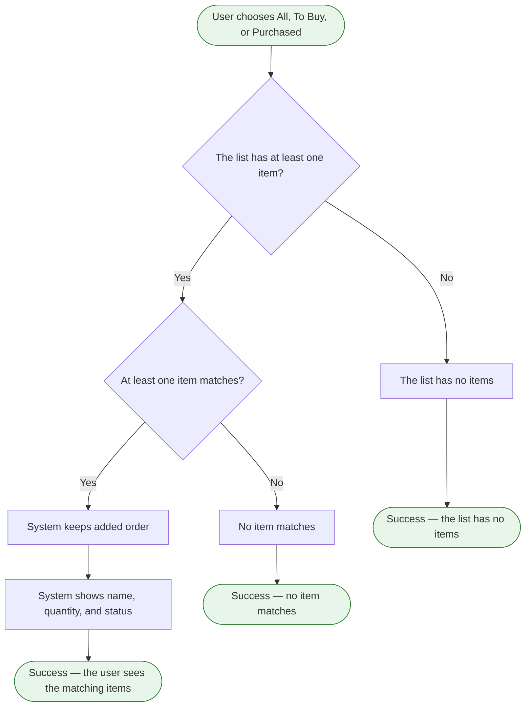

# Filter the shopping list

**Product:** Shopping List
**Use Case:** UC-02 See what is still needed
**Area:** Shopping list
**Capabilities:** Filter the shopping list by All, To Buy, or Purchased
**Version:** 1.5
**Date:** 2026-10-16
**Author:** Liliia (BA)

> The user chooses one filter value. The list shows the items that match.

---

## Overview

**Goal:** Show every item, only items To Buy, or only items Purchased. `[prd]` `[feature-tree]`
**Actors:** User. No permission limits this action to one role.
**Trigger:** The user chooses All, To Buy, or Purchased. This trigger is not the same as looking at the list, so the filter stays its own flow. `[feature-tree]`
**Preconditions:** The view flow has already shown the shopping list. `[gap: whether this flow reads the list again]`

---

## Flow Diagram

---

## Flow Steps

| # | Actor | Action | System Response | Screen / Component | BR |
|---|---|---|---|---|---|
| 1 | User | Chooses All, To Buy, or Purchased | Receives that one value. All, To Buy, and Purchased are the values | `[gap: screen not mapped]` | |
| 2 | System | Applies the chosen value to the items | All keeps every item. All is not a stored status. To Buy keeps items whose status is To Buy. Purchased keeps items whose status is Purchased | `[gap: screen not mapped]` | |
| 3 | System | Keeps the added order | Shown items stay in the order they were added | `[gap: screen not mapped]` |  |
| 4 | System | Shows each matching item | Shows the name, the quantity, and the status | `[gap: screen not mapped]` | |

---

## Error and Edge Cases

| Scenario | Behavior | BR |
|---|---|---|
| The shopping list has zero items | The list shows that it has no items, and the user can add an item. A list with items and no match is a different case. `[gap: message wording]` | |
| The chosen value matches no item | No item is shown for that value. `[gap: message wording]` | |
| The user chooses the value that is already selected | `[gap: whether the list changes]` | |
| The filter reads the list again | `[gap: whether this flow reads the list again]` | |

### Decision Nodes

| After step # | Condition | Yes / Valid → | No / Invalid → | BR |
|---|---|---|---|---|
| 1 | The list has at least one item | Step 2 | The list shows that it has no items | |
| 2 | At least one item matches the chosen value | Step 3 | No item is shown for that value | |

### Error States

| Triggered at step # | Error condition | What the user sees | Recovery path |
|---|---|---|---|
| 2 | No item matches | `[gap: message wording]` | The user chooses another value. `[gap: whether the current value stays selected]` |

---

## Friction Points

No friction is recorded.

**Scope signals:** No scope signal.

---

## Traceability

**Features:** [F-010](../feature-tree.md)
**Entities:** [ITEM](../../domain/erd/entities/ITEM.md). `[gap: whether this flow reads ITEM again]`
**Rules:** 
**NFRs:** none

---

## Version History

| Version | Stage | What changed |
|---|---|---|
| v1.0 | 5.1 General flows | Initial flow from the product sources. Markers only. |
| v1.1 | 5.1 General flows | Markers replaced with catalog identifiers. No step change. |
| v1.2 | 5.1 General flows | Actor is User. No control name and no message wording. |

| v1.3 | 5.1 General flows | Diagram ends and gaps say user. |
| v1.4 | 5.1 General flows | UX, terminology, field-default, and common-behavior identifiers removed. |

| v1.5 | 5.1 General flows | Sorting and confirmation identifiers removed after classification review. |

---

## Sources

| Marker | Source | Link |
|---|---|---|
| `[prd]` | Product requirements document | [PRD.md](../PRD.md) |
| `[feature-tree]` | Feature tree | [feature-tree.md](../feature-tree.md) |
| `[entities]` | Entity specs | [ITEM.md](../../domain/erd/entities/ITEM.md) |
| `[glossary]` | Domain glossary | [domain-glossary.md](../../domain/domain-glossary.md) |
