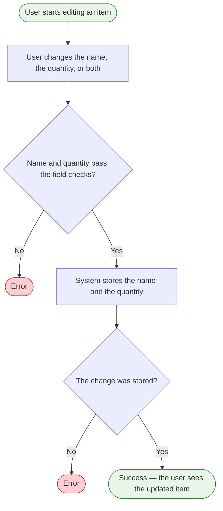

# Edit an item

**Product:** Shopping List
**Use Case:** UC-04 Correct an item
**Area:** Items
**Capabilities:** Edit an item
**Version:** 1.8
**Date:** 2026-10-19
**Author:** Liliia (BA)

> The user changes an item's name, quantity, or both.

---

## Overview

**Goal:** Change the item name, the quantity, or both. `[prd]` `[feature-tree]`
**Actors:** User. No permission limits this action to one role.
**Trigger:** The user starts editing an item. `[prd]`
**Preconditions:** The item is on the shopping list. `[prd]`

---

## Flow Diagram

---

## Flow Steps

| # | Actor | Action | System Response | Screen / Component | BR |
|---|---|---|---|---|---|
| 1 | User | Starts editing an item | Starts the edit for that item | `[gap: screen not mapped]` | |
| 2 | System | Shows the current name and quantity | The status is not part of this change | `[gap: screen not mapped]` | |
| 3 | User | Changes the name, the quantity, or both | Holds the entered values | `[gap: screen not mapped]` | |
| 4 | System | Trims the item name and checks the name and the quantity | The name is required, trimmed, and at most 100 characters. The quantity is a positive whole number, at most 999. These checks stay on the item spec | `[gap: screen not mapped]` | |
| 5 | System | Stores the name and the quantity | A matching item name does not block the change. The added-order time does not change, so the item keeps its place. `[operator-2]` | `[gap: screen not mapped]` | `[BR-001](../business-rules-catalog.md)` |
| 6 | User | Sees the updated item | The list shows the new name and quantity | `[gap: screen not mapped]` | |

---

## Error and Edge Cases

| Scenario | Behavior | BR |
|---|---|---|
| The name or the quantity fails the field checks | The error shows under the field. An empty quantity fails. The entered values stay. The user corrects the field and submits again. `[operator-2]` | |
| The change cannot be stored | A save message shows. The entered values stay. The user submits again. `[operator-2]` | |
| The item is no longer on the list | "This item is no longer on the list." `[operator-2]` | |
| The user leaves before the change is stored | `[gap: whether the previous name and quantity stay]` | |
| The new name matches another item | The change is not blocked. A matching name does not warn. `[operator]` | `[BR-001](../business-rules-catalog.md)` |
| The selected filter | `[gap: whether edit changes the selected filter]` | |

### Decision Nodes

| After step # | Condition | Yes / Valid → | No / Invalid → | BR |
|---|---|---|---|---|
| 4 | The name and the quantity pass the field checks | Step 5 | Error under the field. Back to step 3 with the values kept | |
| 5 | The change was stored | Step 6 | Save message. Back to step 3 with the values kept | |

### Error States

| Triggered at step # | Error condition | What the user sees | Recovery path |
|---|---|---|---|
| 4 | The name or the quantity fails the field checks | The field message from the [ITEM](../../domain/erd/entities/ITEM.md) spec, under the field | The user corrects the field and submits again |
| 5 | The change cannot be stored | "Couldn't save your changes. Try again." | The user submits again. The values stay |
| 5 | The item is no longer on the list | "This item is no longer on the list." | `[gap: whether the edit closes and the list refreshes]` |

---

## Friction Points

No friction is recorded.

**Scope signals:** No scope signal.

---

## Traceability

**Features:** [F-013](../feature-tree.md)
**Entities:** [ITEM](../../domain/erd/entities/ITEM.md) (update)
**Rules:** `[BR-001](../business-rules-catalog.md)`
**NFRs:** none

---

## Version History

| Version | Stage | What changed |
|---|---|---|
| v1.0 | 5.1 General flows | Initial flow from the product sources. Markers only. |
| v1.1 | 5.1 General flows | Markers replaced with catalog identifiers. No step change. |
| v1.2 | 5.1 General flows | Actor is User. Diagram error ends say Error. The edit step no longer names a form or a modal. |

| v1.3 | 5.1 General flows | Diagram ends and gaps say user. |
| v1.4 | 5.1 General flows | UX, terminology, field-default, and common-behavior identifiers removed. |

| v1.5 | 5.1 General flows | Sorting and confirmation identifiers removed after classification review. |

| v1.6 | 5.1 General flows | Rule identifiers renumbered to BR-001 and BR-002. |
| v1.7 | 5.2 Team refinement | A matching item name does not block the edit and does not warn. |
| v1.8 | 6.1 Entity enrichment | Error messages, recovery, the missing-item case, and the unchanged added-order time from the operator-approved entity decisions. |

---

## Sources

| Marker | Source | Link |
|---|---|---|
| `[prd]` | Product requirements document | [PRD.md](../PRD.md) |
| `[feature-tree]` | Feature tree | [feature-tree.md](../feature-tree.md) |
| `[entities]` | Entity specs | [ITEM.md](../../domain/erd/entities/ITEM.md) |
| `[glossary]` | Domain glossary | [domain-glossary.md](../../domain/domain-glossary.md) |
| `[operator]` | Operator, 2026-10-16 | [2026-10-16-flows-and-rules-review.md](../../meeting-notes/2026-10-16-flows-and-rules-review.md) |
| `[operator-2]` | Operator, 2026-10-19 | [2026-10-19-entity-gaps-decisions.md](../../meeting-notes/2026-10-19-entity-gaps-decisions.md) |
