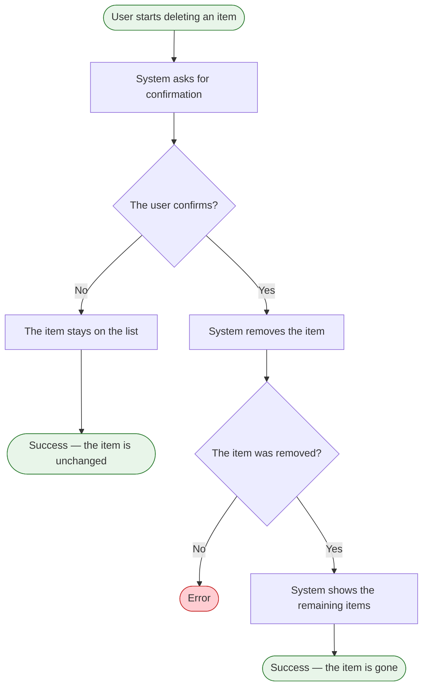

# Delete an item

**Product:** Shopping List
**Use Case:** UC-04 Correct an item
**Area:** Items
**Capabilities:** Delete an item
**Version:** 1.6
**Date:** 2026-10-19
**Author:** Liliia (BA)

> The user deletes an item. The delete asks for confirmation first.

---

## Overview

**Goal:** Remove an item from the shopping list after confirmation. `[prd]` `[feature-tree]`
**Actors:** User. No permission limits this action to one role.
**Trigger:** The user starts deleting an item. `[prd]`
**Preconditions:** The item is on the shopping list. `[prd]`

---

## Flow Diagram

---

## Flow Steps

| # | Actor | Action | System Response | Screen / Component | BR |
|---|---|---|---|---|---|
| 1 | User | Starts deleting an item | Starts the delete for that item | `[gap: screen not mapped]` | |
| 2 | System | Asks for confirmation | Waits for a confirmation | `[gap: screen not mapped]` |  |
| 3 | User | Confirms or does not confirm | Confirmation continues the delete. No confirmation leaves the item on the list | `[gap: screen not mapped]` | |
| 4 | System | Removes the item | The item is no longer on the list | `[gap: screen not mapped]` | |
| 5 | System | Shows the remaining items | The remaining items stay in the order they were added. When none remain, the list shows that it has no items | `[gap: screen not mapped]` |  |

---

## Error and Edge Cases

| Scenario | Behavior | BR |
|---|---|---|
| The user does not confirm | The item stays on the list |  |
| Confirmation is asked | `[gap: confirmation wording]` | |
| The item cannot be removed | "Couldn't delete the item. Try again." The item stays on the list. The user starts the delete again. `[operator-2]` | |
| The item is no longer on the list | "This item is no longer on the list." `[operator-2]` | |
| The deleted item was the last item | The list shows that it has no items. `[gap: message wording]` | |
| A filter is selected and no remaining item matches it | `[gap: whether the no-match message applies after a delete]` | |

### Decision Nodes

| After step # | Condition | Yes / Valid → | No / Invalid → | BR |
|---|---|---|---|---|
| 2 | The user confirms | Step 4 | The item stays on the list |  |
| 4 | The item was removed | Step 5 | Delete message. The item stays on the list | |

### Error States

| Triggered at step # | Error condition | What the user sees | Recovery path |
|---|---|---|---|
| 4 | The item cannot be removed | "Couldn't delete the item. Try again." | The user starts the delete again |
| 4 | The item is no longer on the list | "This item is no longer on the list." | `[gap: whether the list refreshes]` |

---

## Friction Points

No friction is recorded.

**Scope signals:** No scope signal.

---

## Traceability

**Features:** [F-017](../feature-tree.md)
**Entities:** [ITEM](../../domain/erd/entities/ITEM.md) (delete)
**Rules:** 
**NFRs:** none

---

## Version History

| Version | Stage | What changed |
|---|---|---|
| v1.0 | 5.1 General flows | Initial flow from the product sources. Markers only. |
| v1.1 | 5.1 General flows | Markers replaced with catalog identifiers. No step change. |
| v1.2 | 5.1 General flows | Actor is User. The diagram error end says Error. No control name and no message wording. |

| v1.3 | 5.1 General flows | Diagram ends and gaps say user. |
| v1.4 | 5.1 General flows | UX, terminology, field-default, and common-behavior identifiers removed. |

| v1.5 | 5.1 General flows | Sorting and confirmation identifiers removed after classification review. |
| v1.6 | 6.1 Entity enrichment | Error messages, recovery, and the missing-item case from the operator-approved entity decisions. |

---

## Sources

| Marker | Source | Link |
|---|---|---|
| `[prd]` | Product requirements document | [PRD.md](../PRD.md) |
| `[feature-tree]` | Feature tree | [feature-tree.md](../feature-tree.md) |
| `[entities]` | Entity specs | [ITEM.md](../../domain/erd/entities/ITEM.md) |
| `[glossary]` | Domain glossary | [domain-glossary.md](../../domain/domain-glossary.md) |
| `[operator-2]` | Operator, 2026-10-19 | [2026-10-19-entity-gaps-decisions.md](../../meeting-notes/2026-10-19-entity-gaps-decisions.md) |
