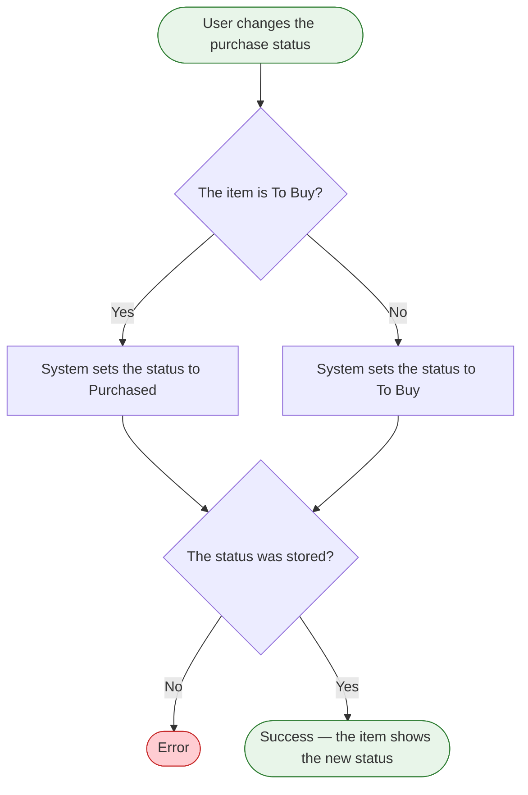

# Change purchase status

**Product:** Shopping List
**Use Case:** UC-03 Mark an item purchased
**Area:** Purchase status
**Capabilities:** Change an item between To Buy and Purchased
**Version:** 1.6
**Date:** 2026-10-19
**Author:** Liliia (BA)

> The user sets an item to Purchased, or returns it to To Buy.

---

## Overview

**Goal:** Change an item between To Buy and Purchased. `[prd]`
**Actors:** User. No permission limits this action to one role.
**Trigger:** The user changes an item between To Buy and Purchased. `[prd]`
**Preconditions:** The item is on the shopping list. Weekly shopping and quick top-up shopping use the same workflow. 

---

## Flow Diagram

---

## Flow Steps

| # | Actor | Action | System Response | Screen / Component | BR |
|---|---|---|---|---|---|
| 1 | User | Changes the purchase status | "Complete" means this same change. The status word is Purchased | `[gap: screen not mapped]` | |
| 2 | System | Sets the status to Purchased | Runs when the item was To Buy | `[gap: screen not mapped]` | |
| 3 | System | Sets the status to To Buy | Runs when the item was Purchased | `[gap: screen not mapped]` | |
| 4 | User | Sees the item | The item shows the new status. `[gap: whether the item stays visible under the current filter]` | `[gap: screen not mapped]` | |

Steps 2 and 3 are the two branches of one change. Only one of them runs.

---

## Error and Edge Cases

| Scenario | Behavior | BR |
|---|---|---|
| The status cannot be stored | "Couldn't save your changes. Try again." The user changes the status again. `[operator-2]` | |
| The item is no longer on the list | "This item is no longer on the list." `[operator-2]` | |
| A filter is selected | `[gap: whether the item stays visible under the current filter]` | |
| The user expects a second workflow for a quick top-up | There is no second workflow | |

### Decision Nodes

| After step # | Condition | Yes / Valid → | No / Invalid → | BR |
|---|---|---|---|---|
| 1 | The item is To Buy | Step 2 | Step 3 | |
| 2 or 3 | The status was stored | Step 4 | Save message. The user changes the status again | |

### Error States

| Triggered at step # | Error condition | What the user sees | Recovery path |
|---|---|---|---|
| 2 or 3 | The status cannot be stored | "Couldn't save your changes. Try again." | The user changes the status again |
| 2 or 3 | The item is no longer on the list | "This item is no longer on the list." | `[gap: whether the list refreshes]` |

---

## Friction Points

No friction is recorded.

**Scope signals:** No scope signal.

---

## Traceability

**Features:** [F-018](../feature-tree.md), [F-019](../feature-tree.md)
**Entities:** [ITEM](../../domain/erd/entities/ITEM.md) (update)
**Rules:** 
**NFRs:** none

---

## Version History

| Version | Stage | What changed |
|---|---|---|
| v1.0 | 5.1 General flows | Initial flow from the product sources. Markers only. |
| v1.1 | 5.1 General flows | Markers replaced with catalog identifiers. No step change. |
| v1.2 | 5.1 General flows | Actor is User. The diagram error end says Error. The step no longer names a control. |

| v1.3 | 5.1 General flows | Diagram ends and gaps say user. |
| v1.4 | 5.1 General flows | UX, terminology, field-default, and common-behavior identifiers removed. |

| v1.5 | 5.1 General flows | Sorting and confirmation identifiers removed after classification review. |
| v1.6 | 6.1 Entity enrichment | Error messages, recovery, and the missing-item case from the operator-approved entity decisions. |

---

## Sources

| Marker | Source | Link |
|---|---|---|
| `[prd]` | Product requirements document | [PRD.md](../PRD.md) |
| `[feature-tree]` | Feature tree | [feature-tree.md](../feature-tree.md) |
| `[entities]` | Entity specs | [ITEM.md](../../domain/erd/entities/ITEM.md) |
| `[glossary]` | Domain glossary | [domain-glossary.md](../../domain/domain-glossary.md) |
| `[operator-2]` | Operator, 2026-10-19 | [2026-10-19-entity-gaps-decisions.md](../../meeting-notes/2026-10-19-entity-gaps-decisions.md) |
