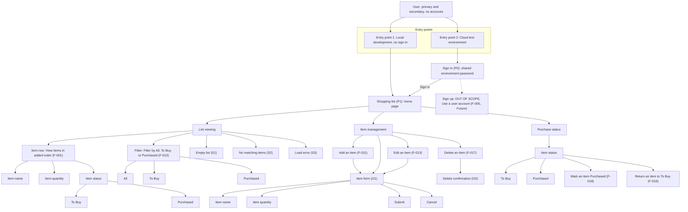

# Sitemap and Navigation Model

**Product:** Shopping List
**Version:** 1.1 (ready for team review)
**Date:** 2026-10-21
**Stage:** 9 — Information architecture, activity 9.1 Sitemap design
**Author:** Designer and BA

> The sitemap in two formats: 1. ASCII tree and 2. Mermaid diagram — which can serve as low-fidelity IA deliverables and as the intro used to build this 3. Screen-Flow Map canvas. Behavior is in the [flows](../product/flows/index.md). Wireframes are out of scope.

---

## 1. Purpose and Finding

The frozen product requirements document and the feature tree describe **one shopping list with seven MVP features**. The three feature-tree areas (Shopping list, Items, Purchase status) are groups of capabilities, not three pages. Making each area a navigation section would invent screens that no flow needs.

**Finding:** the minimum viable product is **a Sign in page (P0, cloud test only), one list page (Shopping list, P1, home), two overlays (Item form, Delete confirmation), and three page states (Empty list, No matching items, Load error)**. The team confirms this at activity 9.4. `[assumed]`

**ERD finding:** the [ERD](../domain/erd/index.md) has two entities, Shopping list ([SHOPPING_LIST](../domain/erd/entities/SHOPPING_LIST.md)) and Item ([ITEM](../domain/erd/entities/ITEM.md)), with one relationship: one list contains many items. Both entities are MVP. There is no entity for a user account, a price, a store, or sharing, so no page is needed to hold their data. Every attribute the user sees or enters (name, quantity, status) has a screen home. See Section 5.

**Sign in and Sign up:**

- **Sign in** is on the sitemap for the cloud test environment. It takes one shared environment password. [ADR-0009](../architecture/decisions/adrs/0009-basic-authentication.md) chose HTTP basic authentication and [ADR-0020](../architecture/decisions/adrs/0020-password-401.md) says no custom page is designed. Whether Sign in is a custom page or the browser prompt is `[gap: Sign in page design]`.
- **Sign up** is **out of scope**. Version 1 has no accounts. [Use a user account (F-005)](../product/feature-tree.md#f-005) is Future.

---

## 2. Inputs

| Input | Used for | Link |
|---|---|---|
| Product requirements document (PRD) v1.13, frozen | Use cases, scope, UX requirements (Section 13), limits (Section 7) | [PRD.md](../product/PRD.md) |
| Feature tree v1.4, baselined | MVP boundary: seven features. Future list | [feature-tree.md](../product/feature-tree.md) |
| Flow index v1.2 and six flows | Reachability check, messages, handoffs | [index.md](../product/flows/index.md) |
| ERD index v1.0 and v1.1 | Entities and the one relationship: one list contains many items. No Future-only entity | [index.md](../domain/erd/index.md) |
| ERD enums | Item status values: To Buy, Purchased. All is not a stored value | [enums.md](../domain/erd/enums.md) |
| Item entity spec v2.1 | Attributes shown, entered, and hidden. Field rules, approved messages, form behavior, state model | [ITEM.md](../domain/erd/entities/ITEM.md) |
| Shopping list entity spec v2.1 | The list has no field the user sees or enters. Created once at deployment. Load-failure message | [SHOPPING_LIST.md](../domain/erd/entities/SHOPPING_LIST.md) |
| Business rules catalog | Duplicate names and the To Buy start status | [business-rules-catalog.md](../product/business-rules-catalog.md) |
| Architecture decisions | Shared password behavior | [ADR-0009](../architecture/decisions/adrs/0009-basic-authentication.md), [ADR-0020](../architecture/decisions/adrs/0020-password-401.md) |

---

## 3. Sitemap

### 3.1 ASCII tree

```
User: primary and secondary (no accounts in version 1)
|
+-- Entry point 1: Local development
|     Open the app, no sign-in ------------------------> Shopping list (P1)
|
+-- Entry point 2: Cloud test environment
|     +-- Sign in (P0)                       shared environment password
|     |     +-- Password
|     |     +-- Sign in  -> Shopping list (P1)
|     |     +-- [gap: custom page or browser prompt]
|     +-- Sign up                            OUT OF SCOPE
|           Use a user account (F-005, Future)
|
+-- Shopping list (P1)                      home, the only page
      |
      +-- List viewing
      |     +-- Item row                    View items in added order (F-001)
      |     |     +-- Item name
      |     |     +-- Item quantity
      |     |     +-- Item status
      |     |           +-- To Buy
      |     |           +-- Purchased
      |     +-- Filter                      Filter by All, To Buy, or Purchased (F-010)
      |     |     +-- All
      |     |     +-- To Buy
      |     |     +-- Purchased
      |     +-- Empty list (S1)
      |     +-- No matching items (S2)
      |     +-- Load error (S3)             [gap: retry control]
      |
      +-- Item management
      |     +-- Add an item (F-011)         [gap: Add pattern]
      |     +-- Item form (O1)
      |     |     +-- Item name
      |     |     +-- Item quantity
      |     |     +-- Submit
      |     |     +-- Cancel                [gap: labels]
      |     +-- Edit an item (F-013)        -> Item form (O1)
      |     +-- Delete an item (F-017)      -> Delete confirmation (O2)
      |           +-- Delete confirmation (O2)
      |                 +-- Confirm delete
      |                 +-- Do not confirm
      |
      +-- Purchase status
            +-- Item status                 [gap: control not agreed]
            |     +-- To Buy
            |     +-- Purchased
            +-- Mark an item Purchased (F-018)
            +-- Return an item to To Buy (F-019)
```

Read it top-down: every user action lands on Sign in (P0), Shopping list (P1), an overlay, or a page state.

### 3.2 Mermaid diagram



### 3.3 Screen-Flow Mapping (FigJam canvas)

Chosen for this project (Yes). Recommended for a stakeholder workshop.

The sitemap in two formats: 1. ASCII tree and 2. Mermaid diagram — which can serve as low-fidelity IA deliverables and as the intro used to build this 3. Screen-Flow Map canvas.

- **Deliverable lives in:** [Design artifacts](https://www.figma.com/board/I2bFmtHKx9wGp4Lxrguntv/Design-artifacts?node-id=23-2)
- **Page:** IA (sitemap + navigation model)
- **What it is:** detailed sitemap and screen-flow mapping — entry points, page blocks, sub-pages, content, metadata cards, actions (primary, secondary, destructive), messages, out-of-scope boxes, and a legend.

### 3.4 Node catalogue

| Node | Type | What it is | Features | Source |
|---|---|---|---|---|
| **P0** Sign in | Page (cloud test only) | One shared environment password. Local development has no sign-in | none | [ADR-0009](../architecture/decisions/adrs/0009-basic-authentication.md), [ADR-0020](../architecture/decisions/adrs/0020-password-401.md) |
| **P1** Shopping list | Page (home) | The one list. Each item shows name, quantity, status. Items stay in added order | [F-001](../product/feature-tree.md#f-001) View items in added order | `[prd S5]` [UC-02](../product/PRD.md) |
| Filter control | Component on P1 | Chooses All, To Buy, or Purchased. One value at a time | [F-010](../product/feature-tree.md#f-010) Filter by All, To Buy, or Purchased | `[prd S5]` |
| Status control | Component on P1 | Moves an item between To Buy and Purchased. Purchased must look clearly different. PRD Section 13 says checkbox. The item spec says the control is not agreed | [F-018](../product/feature-tree.md#f-018) Mark an item Purchased, [F-019](../product/feature-tree.md#f-019) Return an item to To Buy | `[prd S13]` |
| **O1** Item form | Overlay | Small form or modal for item name and quantity. Used for Edit. Used for Add when Add uses the form | [F-013](../product/feature-tree.md#f-013) Edit an item, [F-011](../product/feature-tree.md#f-011) Add an item | `[prd S13]` |
| **O2** Delete confirmation | Overlay | Asks the user to confirm before removal. No confirmation leaves the item | [F-017](../product/feature-tree.md#f-017) Delete an item | `[prd S13]` |
| **S1** Empty list | Page state | Short message such as "Your shopping list is empty" plus a clear Add Item action | [F-001](../product/feature-tree.md#f-001), [F-011](../product/feature-tree.md#f-011) | `[prd S13]` |
| **S2** No matching items | Page state | Message that no items match the chosen filter | [F-010](../product/feature-tree.md#f-010) | `[prd S13]` |
| **S3** Load error | Page state | "Couldn't load your shopping list. Try again." | [F-001](../product/feature-tree.md#f-001) | [Flow 1](../product/flows/FLOW_01_VIEW_SHOPPING_LIST.md) |

---

## 4. Page Content, Metadata, and Actions

### 4.1 Sign in (P0)

| Aspect | Content |
|---|---|
| **Content** | Password field for the shared environment password |
| **Metadata** | Cloud test only. Source [ADR-0009](../architecture/decisions/adrs/0009-basic-authentication.md), [ADR-0020](../architecture/decisions/adrs/0020-password-401.md). Route and page design: `[gap]` |
| **Primary action** | Sign in |
| **Message** | Wrong or missing password returns 401. `[gap: message text]` |
| **Out of scope** | Sign up. [Use a user account (F-005)](../product/feature-tree.md#f-005) is Future |

### 4.2 Shopping list (P1)

| Aspect | Content |
|---|---|
| **Content** | Item rows (name, quantity, status), filter control, row actions, Add Item action. Identifier, list identifier, and timestamps stay hidden ([ITEM](../domain/erd/entities/ITEM.md)) |
| **Metadata: use cases** | • [Add an item (UC-01)](../product/PRD.md)<br>• [See what is still needed (UC-02)](../product/PRD.md)<br>• [Mark an item purchased (UC-03)](../product/PRD.md)<br>• [Correct an item (UC-04)](../product/PRD.md) |
| **Metadata: features** | • [View items in added order (F-001)](../product/feature-tree.md#f-001)<br>• [Filter by All, To Buy, or Purchased (F-010)](../product/feature-tree.md#f-010)<br>• [Add an item (F-011)](../product/feature-tree.md#f-011)<br>• [Edit an item (F-013)](../product/feature-tree.md#f-013)<br>• [Delete an item (F-017)](../product/feature-tree.md#f-017)<br>• [Mark an item Purchased (F-018)](../product/feature-tree.md#f-018)<br>• [Return an item to To Buy (F-019)](../product/feature-tree.md#f-019) |
| **Metadata: entities** | • [SHOPPING_LIST](../domain/erd/entities/SHOPPING_LIST.md): read<br>• [ITEM](../domain/erd/entities/ITEM.md): read |
| **Metadata: attributes shown** | • Item name<br>• Item quantity<br>• Item status (To Buy or Purchased) |
| **Metadata: limits** | • Page load and save within 3 seconds<br>• 10 users<br>• 200 items |
| **Metadata: devices** | • Desktop browser<br>• Tablet browser<br>• Phone browser |
| **Metadata: route** | `[gap]` |
| **Primary actions** | Add Item. Mark an item Purchased |
| **Secondary actions** | Edit. Return an item to To Buy. Filter values All, To Buy, Purchased |
| **Destructive action** | Delete |
| **Entry** | From Sign in (cloud test) or directly (local development) |
| **Exit** | None. Shopping list (P1) is the only page. Overlays and states return to it |

### 4.3 Item form (O1)

| Aspect | Content |
|---|---|
| **Content** | • Item name: required, trimmed, at most 100 characters. Input stops at 100 characters<br>• Quantity: whole number 1 to 999. A number input in whole steps, showing 1 before entry. Default 1 on add<br>• On Edit, the form shows the current name and quantity<br>• Status is not part of the form<br>• Duplicate names allowed ([BR-001](../product/business-rules-catalog.md)) |
| **Entity** | [ITEM](../domain/erd/entities/ITEM.md): created on Add, updated (name, quantity) on Edit |
| **Primary action** | Submit. `[gap: label]` |
| **Secondary action** | Cancel. `[gap: not in the flows]` |
| **Messages under the field** | • "Enter an item name."<br>• "Item name can be up to 100 characters."<br>• "Quantity must be a whole number from 1 to 999." |
| **Messages above the form** | • "Couldn't save your changes. Try again."<br>• On Edit, if the item was removed: "This item is no longer on the list." |
| **Behavior after an error** | • Entered values stay<br>• Focus moves to the first field with an error<br>• Submit stays enabled<br>• A failed save keeps the form open |

### 4.4 Delete confirmation (O2)

| Aspect | Content |
|---|---|
| **Content** | Asks before removal |
| **Destructive action** | Confirm delete |
| **Secondary action** | Do not confirm. The item stays on the list |
| **Messages** | "Couldn't delete the item. Try again." "This item is no longer on the list." |

### 4.5 Purchase status (on Shopping list, P1)

| Aspect | Content |
|---|---|
| **Statuses** | • To Buy (new items start here, [BR-002](../product/business-rules-catalog.md))<br>• Purchased<br>• All is a filter value, not a stored status ([enums](../domain/erd/enums.md)) |
| **Entity** | [ITEM](../domain/erd/entities/ITEM.md): status updated. Edit keeps the current status |
| **Primary action** | Mark an item Purchased |
| **Secondary action** | Return an item to To Buy |
| **Messages** | "Couldn't save your changes. Try again." "This item is no longer on the list." |

---

## 5. Entities and Screens (from the ERD)

The [ERD](../domain/erd/index.md) has two entities and one relationship: one Shopping list contains many Items. This version has one list. The list can have no items.

### 5.1 Which screen reads or changes each entity

| Entity | Read | Create | Update | Delete |
|---|---|---|---|---|
| [SHOPPING_LIST](../domain/erd/entities/SHOPPING_LIST.md) | • Shopping list (P1): view and filter<br>• Empty list (S1)<br>• Load error (S3) | None. Created once at deployment, a transition requirement | None | None |
| [ITEM](../domain/erd/entities/ITEM.md) | • Shopping list (P1): item rows<br>• Item form (O1): current name and quantity on Edit | • Item form (O1) on Add item (F-011), unless Add is inline `[gap: Add pattern]` | • Item form (O1): name and quantity<br>• Status control: status | • Delete confirmation (O2) |

### 5.2 Which screen holds each attribute

| Entity.attribute | User sees it | User enters it | Shown on | Entered on |
|---|---|---|---|---|
| ITEM.name | Yes | Yes | Item row on Shopping list (P1) | Item form (O1) |
| ITEM.quantity | Yes | Yes. Default 1 | Item row on Shopping list (P1) | Item form (O1) |
| ITEM.status (To Buy, Purchased) | Yes | Changed with the status control. New items start as To Buy | Item row on Shopping list (P1) | Status control on Shopping list (P1) |
| ITEM.itemId, ITEM.listId, ITEM.createdAt, ITEM.updatedAt | No. System values | No | Nowhere. Added order follows createdAt | Nowhere |
| SHOPPING_LIST.listId | No. System value | No | Nowhere | Nowhere |

✅ Every attribute the user sees or enters has a screen home. Hidden attributes need none.

### 5.3 Item states shown on screens

- To Buy: a new item starts here. The Item row shows it as To Buy.
- To Buy to Purchased: Mark an item Purchased (F-018), with the status control.
- Purchased to To Buy: Return an item to To Buy (F-019), with the status control.
- Delete: allowed in either state, through Delete confirmation (O2).
- Edit keeps the current status.

### 5.4 What the ERD changes in the sitemap

- **No account entity:** no page holds account data. This supports Sign up as out of scope. Sign in has no entity either: it checks one shared environment password.
- **No entity for the list screen itself:** Shopping list has no field the user enters, so it needs no form or settings page.
- **Messages and form behavior:** taken from the Item spec, not written again. Field messages show under the field. The save failure shows above the form.
- **Status control:** the Item spec v2.1 says the control is not agreed. PRD Section 13 says Purchased is a checkbox. The sitemap keeps the PRD wording and records `[gap: status control]`.

---

## 6. Navigation Model

| Navigation type | In version 1 | Reason |
|---|---|---|
| **Primary** | None | One home page (Shopping list, P1). The three feature-tree areas are not sections. `[assumed]` |
| **Secondary** | Filter control on the Shopping list (P1): All, To Buy, Purchased | A view switch inside the one page, not a route. [Filter by All, To Buy, or Purchased (F-010)](../product/feature-tree.md#f-010) |
| **Utility** | Add Item, Edit, Delete, status control | Item actions on Shopping list (P1) |
| **Footer** | None | No source asks for a footer. Not invented |
| **Entry** | Entry point 1, local development, goes to Shopping list (P1). Entry point 2, cloud test, goes to Sign in (P0), then Shopping list (P1) | [ADR-0009](../architecture/decisions/adrs/0009-basic-authentication.md) |

- **Roles:** none in version 1. No accounts. One navigation tree for everyone. [PRD Section 3](../product/PRD.md)
- **Devices:** one responsive browser interface for desktop, tablet, and phone. Native mobile application is Future ([Use a native mobile application (F-009)](../product/feature-tree.md#f-009)).
- **Out of scope (Future), no node:** [Keep more than one shopping list (F-002)](../product/feature-tree.md#f-002), [Keep a store-specific shopping list (F-003)](../product/feature-tree.md#f-003), [Import or export the shopping list (F-004)](../product/feature-tree.md#f-004), [Use a user account (F-005)](../product/feature-tree.md#f-005), [Share the list with a controlled set of people (F-006)](../product/feature-tree.md#f-006), [Set user permissions (F-007)](../product/feature-tree.md#f-007), [Send a notification (F-008)](../product/feature-tree.md#f-008), [Use a native mobile application (F-009)](../product/feature-tree.md#f-009), [Add an item from a barcode (F-012)](../product/feature-tree.md#f-012), [Record a price (F-014)](../product/feature-tree.md#f-014), [Set an item unit (F-015)](../product/feature-tree.md#f-015), [Attach a product image (F-016)](../product/feature-tree.md#f-016).

---

## 7. Reachability Check

| Flow | Starts at | Passes through | Ends at |
|---|---|---|---|
| [Flow 1 — View the shopping list](../product/flows/FLOW_01_VIEW_SHOPPING_LIST.md) | Entry point 1, or Sign in (P0) | Shopping list (P1), or Empty list (S1), or Load error (S3) on a read failure | Shopping list (P1) |
| [Flow 2 — Filter the shopping list](../product/flows/FLOW_02_FILTER_SHOPPING_LIST.md) | Filter control on Shopping list (P1) | Shopping list (P1) | Shopping list (P1), or No matching items (S2) when nothing matches |
| [Flow 3 — Add an item](../product/flows/FLOW_03_ADD_ITEM.md) | Add Item action on Shopping list (P1), or Empty list (S1) | Item form (O1), or inline field `[gap: Add pattern]` | Shopping list (P1) |
| [Flow 4 — Edit an item](../product/flows/FLOW_04_EDIT_ITEM.md) | Edit action on an item row | Item form (O1) | Shopping list (P1) |
| [Flow 5 — Delete an item](../product/flows/FLOW_05_DELETE_ITEM.md) | Delete action on an item row | Delete confirmation (O2) | Shopping list (P1), or Empty list (S1) when none remain |
| [Flow 6 — Change purchase status](../product/flows/FLOW_06_CHANGE_PURCHASE_STATUS.md) | Status control on Shopping list (P1) | Shopping list (P1) | Shopping list (P1) |

✅ All six flows are reachable. This project uses the FigJam canvas (3.3) as Screen-Flow Mapping.

---

## 8. Open Gaps

| # | Gap | Effect on the sitemap | Needs |
|---|---|---|---|
| 1 | `[gap: Add pattern]` Flow 3 names no control. Inline field or the Item form (O1) is open | Add Item leads to the Item form (O1) or to an inline field | Team decision at 9.4 |
| 2 | `[gap: Sign in page design]` Custom page or browser prompt. [ADR-0020](../architecture/decisions/adrs/0020-password-401.md) says no custom page | Sign in (P0) is drawn as a page. Its design is open | Team and architect |
| 3 | `[gap: whether an empty list starts the add flow]` | Empty list (S1) shows an Add Item action in [PRD Section 13](../product/PRD.md). Whether it opens the form directly is open | [Flow index](../product/flows/index.md) |
| 4 | `[gap: whether the item stays visible under the current filter]` after a status change | Shopping list (P1) versus No matching items (S2) after a change | [Flow 6](../product/flows/FLOW_06_CHANGE_PURCHASE_STATUS.md) |
| 5 | `[gap: retry control or page reload]` for Load error (S3) | Load error (S3) has no outgoing action | [Flow 1](../product/flows/FLOW_01_VIEW_SHOPPING_LIST.md) |
| 6 | `[gap: control placement and labels]` Edit, Delete, Submit, Cancel, and the 401 message are not specified | Actions listed by name only | Design |
| 7 | `[gap: accessibility]` and keyboard navigation are deferred to architecture vision | No effect on structure | [PRD Section 14](../product/PRD.md) |
| 8 | `[gap: status control]` The Item spec v2.1 says the control is not agreed. PRD Section 13 says checkbox | Status control is drawn as a Purchased checkbox per PRD | Team and designer |

---

## Version History

| Version | Stage | What changed |
|---|---|---|
| v0.1 | 9.1 Sitemap design | First draft. One page, two overlays, three states. Six gaps recorded |
| v0.2 | 9.1 Sitemap design | Added Sign in (P0) and Sign up out of scope. Added page content, metadata, and actions (Section 4). FigJam changed from a workflow chart to a sitemap. Seven gaps |
| v0.3 | 9.1 Sitemap design | ASCII tree and Mermaid use Name (code) instead of bare codes. Entry points are on one level in Mermaid. Reachability and gaps use names |
| v0.4 | 9.1 Sitemap design | Shopping list (P1) metadata split into rows with one bullet per item. Use case links open the PRD file without an anchor |
| v1.1 | 9.1 Sitemap design | 3.3 wording: sitemap in two formats as low-fidelity IA; URL labeled Deliverable lives in |
| v1.0 | 9.1 Sitemap design | Ready for team review. FigJam 3.3 is the chosen Screen-Flow Mapping. ASCII and Mermaid stay required |
| v0.9 | 9.1 Sitemap design | FigJam canvas moved to 3.3 Screen-Flow Mapping (FigJam canvas). Node catalogue is 3.4. Section 9 removed |
| v0.8 | 9.1 Sitemap design | Diagrams show pages, blocks, filters, options, and simple field names. Hidden values and messages stay in Section 4 and FigJam. ERD is optional |
| v0.7 | 9.1 Sitemap design | ASCII tree and Mermaid use plain field names. No ERD identifiers in parentheses. Visible fields unlabeled; Hidden only |
| v0.6 | 9.1 Sitemap design | ASCII tree and Mermaid list entity attributes and status values under each screen. FigJam named as the 9.2 stakeholder mapping |
| v0.5 | 9.1 Sitemap design | ERD added as an input. New Section 5 Entities and Screens. Item form behavior and messages from the Item spec. Status control gap recorded. Eight gaps |

---

## Sources

| Marker | Source | Link |
|---|---|---|
| `[prd]` | Product requirements document | [PRD.md](../product/PRD.md) |
| `[feature-tree]` | Feature tree | [feature-tree.md](../product/feature-tree.md) |
| `[flow n]` | Flows | [index.md](../product/flows/index.md) |
| `[erd]` | ERD index, enums, and entity specs | [index.md](../domain/erd/index.md), [enums.md](../domain/erd/enums.md), [ITEM.md](../domain/erd/entities/ITEM.md), [SHOPPING_LIST.md](../domain/erd/entities/SHOPPING_LIST.md) |
